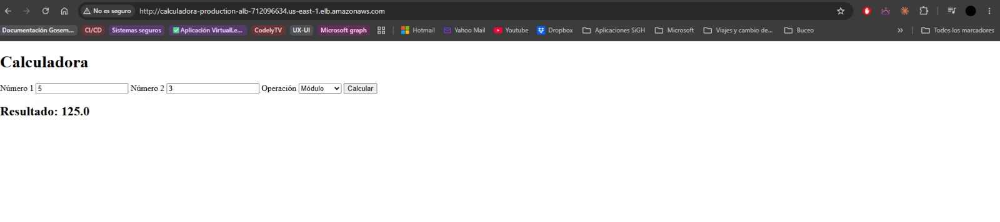
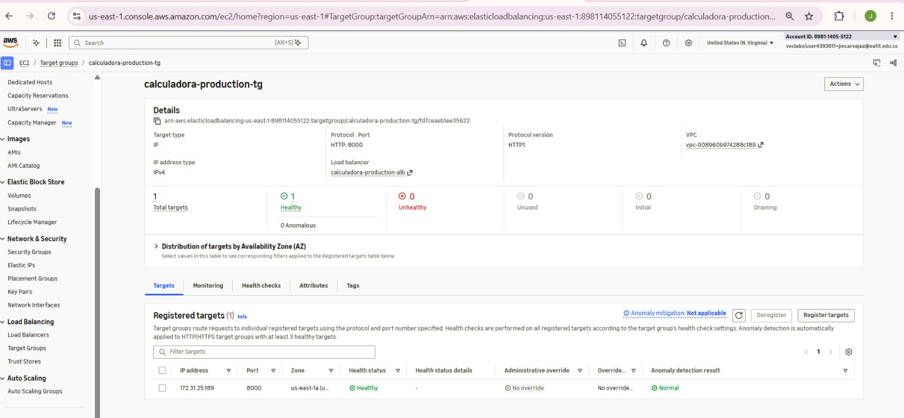

# cicd-pipeline-python

CI/CD - EAFIT 

## Integrantes

Santiago Mesa Valencia | Jose Manuel Carvajal Aristizabal | Mateo Montoya Aristizabal

## Evidencias 

-URL de la ejecución del pipeline del merge de las nuevas funciones (sección 7.12):
 https://github.com/Jcarvajal0810/cicd-pipeline-python-cd/actions/runs/43753619042

-URL del Pull Request de las nuevas funciones:
https://github.com/Jcarvajal0810/cicd-pipeline-python-cd/pull/1

-URL del ALB de Staging y URL del ALB de Producción
http://calculadora-staging-alb-1838596257.us-east-1.elb.amazonaws.com/
http://calculadora-production-alb-712096634.us-east-1.elb.amazonaws.com/

## Capturas

## Preguntas

### i. 

Commit: un push a main dispara todo el pipeline. En un PR solo corre build-and-test, sin publicar ni desplegar.
build-and-test: revisa formato y linters, corre las pruebas unitarias con cobertura mínima del 80 %, valida Terraform, construye la imagen, la prueba localmente con Selenium, ejecuta SonarCloud y, si es main, publica la imagen.
deploy-staging: terraform apply en el workspace staging crea o actualiza ECS Fargate, el ALB y los security groups con la imagen nueva, y espera a que el servicio quede estable.
test-staging: espera a que /health devuelva el SHA del commit y corre las pruebas de aceptación con Selenium contra el ALB.
Aprobación: el environment production de GitHub pausa el pipeline hasta que un revisor aprueba (la regla se configura en Settings - environments, no en el YAML).
deploy-production: el mismo Terraform y la misma imagen, en el workspace production.
smoke-test-production: espera la versión nueva y corre las pruebas de humo.

Unitarias y de componente: la lógica de la calculadora y las rutas de la app, de forma aislada.
Aceptación: el flujo completo como usuario en un navegador (llenar el formulario, calcular, comparar el resultado exacto), incluidos los errores de división por cero y entrada inválida.
Humo: solo que el despliegue quedó vivo y con la versión correcta (la página carga y /health responde ok con el SHA esperado).

### ii.

 Ventajas

El mismo código crea staging y producción idénticos; solo cambia el workspace.
La infraestructura queda versionada en Git, se revisa en PR y se puede revertir.
El pipeline despliega solo, sin clics manuales.
terraform destroy borra todo, útil en una cuenta de laboratorio.

Desventajas

Hay que aprender HCL, estado, workspaces y backend.
Para algo pequeño y único, la consola es más rápida.
Si alguien cambia algo a mano en la consola, el estado se desincroniza.
Un apply automático con un error puede dañar recursos en segundos.

Por qué el estado va en S3 :Es una fuente única de verdad: el pipeline y cualquier persona del equipo leen el mismo estado.

### iii. 

La ventaja más grande es que Staging nos deja probar la misma que después va a producción, con la misma infraestructura, pero sin que nadie dependa de ella. O sea, si algo se va a romper, que se rompa ahí y no en producción y nos pasó un caso en el que las pruebas de aceptación con Selenium pasaban perfecto en local y en build and test, pero fallaron en test staging. 

### iv. 

En Staging test-staging corremos las pruebas de aceptación con Selenium y ya ahi el navegador real abre la calculadora, prueba cada operación y también los errores, como dividir por cero y en cambio, en producción smoke test production solo hacemos pruebas de humo que nos  confirman que la página carga y que /health responde ok con el SHA del commit que desplegamos. 

### v. 

La primera es la observabilidad con alertas automáticas. Hoy el pipeline solo sabe si la versión quedó sana en el momento del despliegue: el health check del ALB y las pruebas de humo revisan un instante. Después nadie mira la tasa de errores 5xx, la latencia ni el consumo de CPU y memoria. Sin esas métricas no se detectan las fallas que aparecen con el uso real, y no hay base para hacer un rollback por degradación ni para medir métricas DORA como el MTTR. Se podría implementar con alarmas de CloudWatch sobre las métricas del ALB y del servicio ECS, notificaciones a correo o Slack y un dashboard por ambiente. Más adelante se le podría sumar tracing distribuido.

La segunda es la seguridad dentro de CD (DevSecOps). SonarCloud analiza el código fuente, pero nadie revisa la imagen Docker que se despliega ni la configuración de Terraform. Tampoco se ataca la aplicación ya en ejecución. Una imagen base con vulnerabilidades o un Security Group mal configurado podrían llegar a Producción sin que el pipeline lo note. Se implementaría con Trivy escaneando la imagen antes del push, Checkov o tfsec revisando la carpeta infra/ en build-and-test, y OWASP ZAP como escaneo DAST contra Staging antes de la aprobación.

### vi.

-Jose Manuel Carvajal Aristizabal: La verdad ver el pipeline completo trabajando fue lo más valioso. Hacer un cambio, subir la rama, abrir el PR y que automáticamente corrieran las pruebas, sonarCloud, la imagen y los despliegues a Staging y a producción es muy distinto a hacerlo todo a mano. Cuando algo fallaba, el pipeline decía exactamente en qué paso, y eso ahorraba mucho tiempo. También me gustó la aprobación manual antes de producción que era abrir Staging, probar las operaciones nuevas  y recién ahí aprobar, da bastante tranquilidad y nos ayuda brindandonos unas mejores practicas.

-Santiago Mesa Valencia: Mi rol fue revisar, aprobar e integrar el Pull Request de las nuevas operaciones y luego aprobar el despliegue a Producción. Lo que más valoré del CI/CD fue que la revisión no dependía solo de mi lectura del código. Cuando abrí el PR, el check build-and-test ya mostraba que el formato, las pruebas unitarias, de componente y de aceptación, la cobertura y el Quality Gate estaban en verde, así que pude concentrarme en la lógica y en que las pruebas cubrieran también los casos de error. El tropiezo fue que no habíamos configurado los revisores requeridos en el ambiente production, así que la primera ejecución del merge desplegó a Producción de forma automática, como Despliegue Continuo. Configuramos la regla, usamos Re-run all jobs y esta vez el pipeline se detuvo en deploy-production hasta que lo aprobé. Eso me dejó clara la diferencia entre Entrega Continua y Despliegue Continuo: el workflow era el mismo y solo cambió la regla del ambiente. Antes de aprobar abrí Staging, probé las operaciones nuevas. Sentí que aprobaba algo ya validado en un ambiente real y no a ciegas.

-Mateo Montoya: la integración de las dos funcionalidades fue muy cómoda y si ningún inconveniente, en mi experiencia el seteo de la infraestructura con terraform me pareció muy cómoda y muy poderosa.

### vii.  

Con la aprobación manual, el pipeline implementa Entrega Continua. Cada cambio integrado en main se construye, se prueba y se despliega solo en Staging. En cambio, el job deploy-production queda en espera hasta que un revisor del ambiente production lo apruebe. Siempre hay una versión validada lista para liberar, pero la decisión de llevarla a producción la toma una persona. Si se quitara esa regla, el mismo flujo sería Despliegue Continuo.

Antes de aprobar, abrimos la URL de Staging y probamos las operaciones nuevas (potencia y módulo), incluido el caso de error del módulo por cero. Confirmamos que el job test-staging y su reporte de aceptación estuvieran en verde.

Si una versión nueva no pasara el health check, el ALB la marcaría como unhealthy y no le enviaría tráfico. ECS reemplazaría la tarea, y tras varios intentos fallidos el circuit breaker marcaría el despliegue como fallido y haría rollback automático a la Task Definition anterior. La tarea vieja nunca deja de atender, porque el mínimo saludable es 100%. El pipeline lo detecta de dos formas: terraform apply termina con error porque espera el estado estable del servicio. Si pasa en Staging, el pipeline se detiene y la versión defectuosa nunca llega a Producción.

